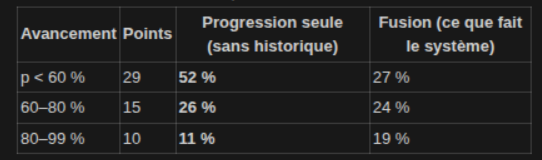
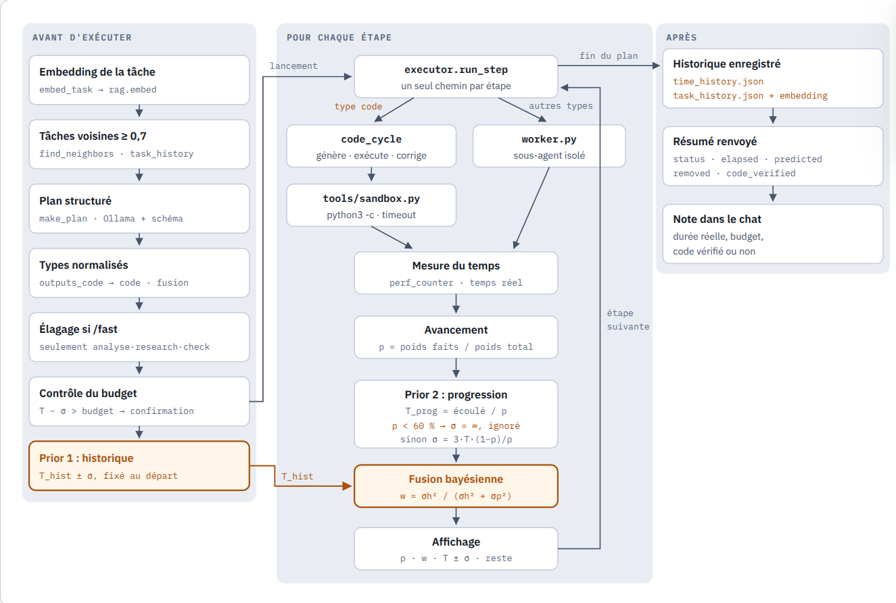
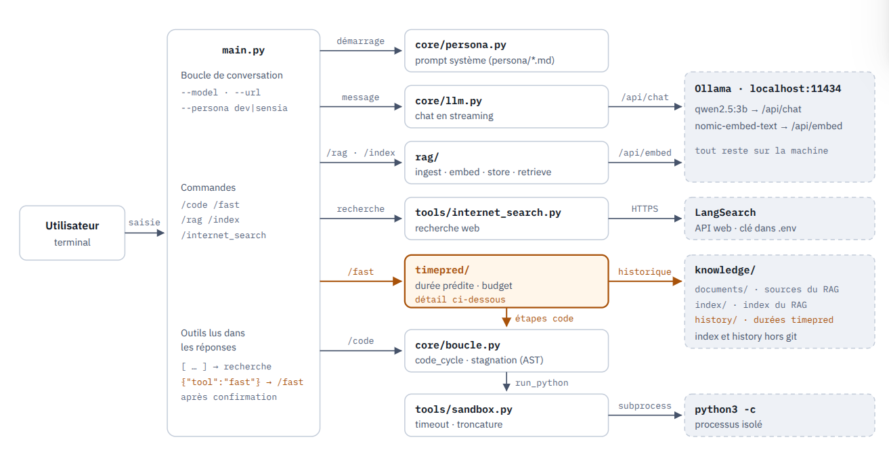

Sensia, agent développeur (pas orienté rag first)

-Tool calling(internet research first, ect)
-Sandbox d'exécution[PIERRE]
-Boucle de réflexion[PIERRE]
-Refactor en modules(separation des responsabilité)
-Évaluation + persistance (+ memorisation info impotrante)

##Architecture

```
main.py

core/
    llm.py

tools/

memory/

```







note : les history sont local -> defondable en disant que c'tes pour augmenter la spécialisation de prediction de temps du harness aux taches redondantes d'un user spécifique localement -> ca ne sert a rien de push l'history dcp
