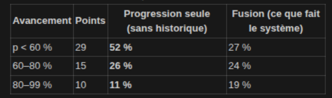
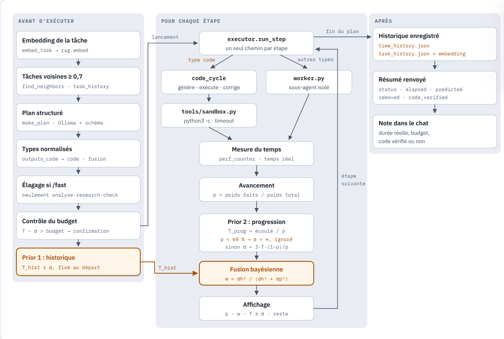
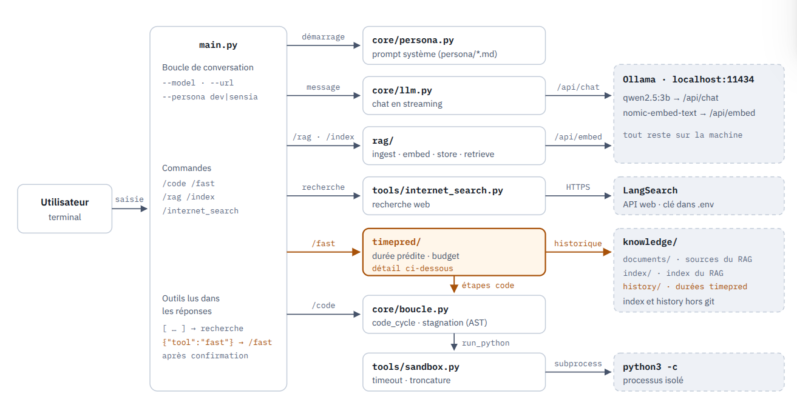
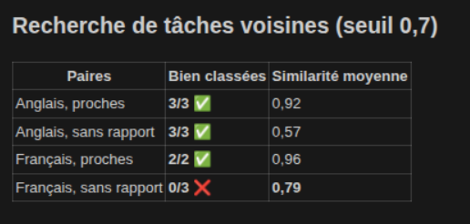
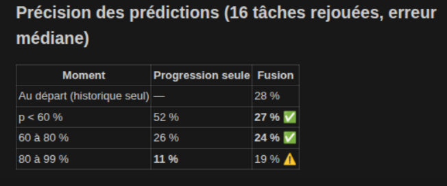

Sensia, agent développeur (pas orienté rag first)

-Tool calling(internet research first, ect)
-Sandbox d'exécution[PIERRE]
-Boucle de réflexion[PIERRE]
-Refactor en modules(separation des responsabilité)
-Évaluation + persistance (+ memorisation info impotrante)

##Architecture

```
main.py

core/
    llm.py

tools/

memory/

```









pourcentage d'erreur suivantle p :


2 Priors:

-L'historique (prior fix apprenable et spécifique a l'user)(N'utiliser les voisins pour un type que s'ils ont au moins 2 ou 3 mesures, sinon garder la moyenne du type)

-Le partitionning de tache ou vitesse du jour (prior mobile apprenable et spécifique a l'user) (les poids appris sont un ingrédient de la vitesse du jour.) -> du jour veut dire mobile

En gros la fusion sert d'etat de transition entre les deux prior (rajoute du smoothness ) et permet de ne pas fixer de regle fix

- Dans les 80 dernier pourcent on passe en mode partitionning de tache only car meilleurs résutlats

-A partir de 60 pourcent il y'a des réevaluation tout les n pourcent afin de porévenir d'un dépassement de token inopiné avec deux scénario(fusion vs prediciton seule) -> on prend le plus mauvais pour avertir l'user

Note : les history sont local -> defendable en disant que c'tes pour augmenter la spécialisation de prediction de temps du harness aux taches redondantes d'un user spécifique localement -> ca ne sert a rien de push l'history dcp
pareille pour le poids des tache apprise localement pour la partitionnign de tache correspodnant a la config propre a l'user

Les limites de notre approche :
- Si l'user change de model ou de routines de tache l'efficacité du timepred recommence a zero
-Pareille si il change de machine

en gros notre model est concu pour quelqu'un fais souvent les meme taches mais ne change pas souvent de support ou de model (cependant notre harness est agnostic au model et a la config)
